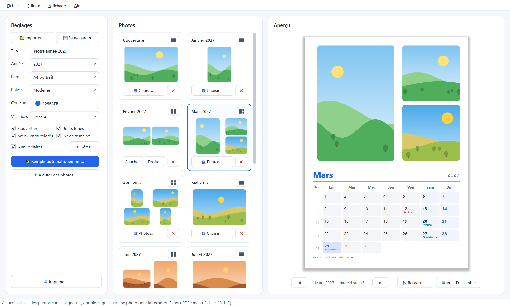
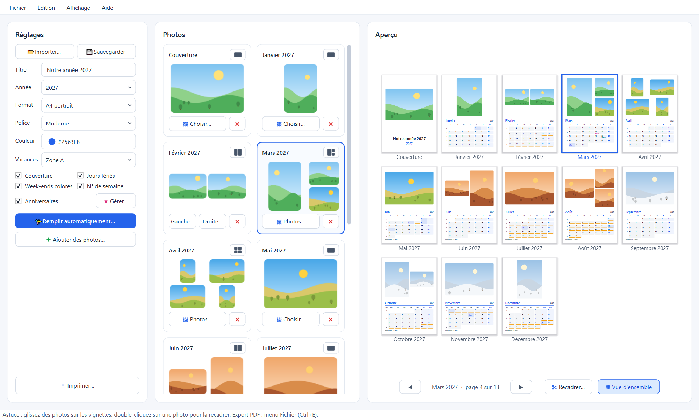

# Calendrier Photo

Créez un calendrier personnalisé avec vos photos, puis exportez-le en PDF prêt à imprimer.
Une à quatre photos par mois, jours fériés et vacances scolaires françaises, anniversaires et événements.



## Fonctionnalités

- **Couverture et 12 mois**, au format A4 ou A3, en portrait ou en paysage.
- **Une à quatre photos par page** : une photo, deux côte à côte, une grande et deux petites, ou une mosaïque.
- **Remplissage automatique** : sélectionnez toutes vos photos ; elles sont classées par date de prise de vue
  et la disposition de chaque page est choisie pour les utiliser toutes, portraits et paysages dans les cadres de
  leur format.
- **Recadrage** de chaque photo (zoom et position), ou photo entière.
- **Jours fériés** (France métropolitaine) et **vacances scolaires** des zones A, B et C.
- **Numéros de semaine**, week-ends en couleur, choix de la police et de la couleur.
- **Anniversaires et événements** : avec l'âge pour les anniversaires ; import et export de la liste au format CSV
  (ouvrable avec Excel) pour la reprendre d'une année sur l'autre.
- **Vue d'ensemble** de toutes les pages, **annuler et rétablir**, projets récents, **sauvegarde automatique**
  avec récupération après une fermeture imprévue.
- Avertissement si une photo importée est **déjà utilisée** dans le calendrier (même sous un autre nom).
- **Export PDF** en 300 dpi et **impression** ; les cadres restés vides ne sont pas imprimés.



## Utiliser l'application

Téléchargez `Calendrier Photo.exe` depuis la page **Releases** de ce dépôt et lancez-le : rien à installer.

> Windows peut afficher « Windows a protégé votre ordinateur », car l'exécutable n'est pas signé numériquement.
> Cliquez sur **Informations complémentaires**, puis sur **Exécuter quand même**.

Un projet (photos choisies, dispositions, recadrages, réglages, anniversaires) se sauvegarde dans un fichier
`.calendrier.json`, pour reprendre le calendrier plus tard.

### Photos modèles

Pour essayer l'application sans vos propres photos, le dossier `exemples/` contient 36 paysages dessinés (aucune
photo réelle), trois par mois aux couleurs de la saison, en portrait et en paysage. Cliquez sur
**Remplir automatiquement…** et sélectionnez-les toutes : la date contenue dans leur nom (`2027-03-15-…`) les range
mois par mois. Le dossier se régénère avec `python make_exemples.py`.

## Lancer depuis le code source

Développé et testé sous Windows avec Python 3.15 et PySide6 6.12.

```
pip install PySide6
python calendrier.py
```

## Construire l'exécutable

```
pip install pyinstaller
python -m PyInstaller --clean "Calendrier Photo.spec"
```

Le résultat est `dist\Calendrier Photo.exe`, un seul fichier sans console. Il n'est pas compressé avec UPX : sur
d'autres PC, les antivirus (McAfee, Windows Defender) bloquaient les DLL compressées et l'application ne démarrait
pas (« DLL load failed while importing QtCore »).

L'icône `Calendrier Photo.ico` est générée par `python make_icon.py`.

## Fichiers

| Fichier | Rôle |
|---|---|
| `calendrier.py` | l'application |
| `make_icon.py` | génère l'icône de l'exécutable |
| `make_exemples.py` | génère les photos modèles du dossier `exemples/` |
| `Calendrier Photo.spec` | recette de construction de l'exécutable (PyInstaller) |
| `Calendrier Photo.ico` | icône |
| `captures/` | captures d'écran de ce README (illustrations générées, aucune photo réelle) |
| `exemples/` | photos modèles pour essayer l'application (paysages dessinés) |

## Vacances scolaires

Les dates sont celles du ministère de l'Éducation nationale (jeu de données
[« Calendrier scolaire »](https://data.education.gouv.fr/explore/dataset/fr-en-calendrier-scolaire/),
Licence Ouverte), intégrées au programme jusqu'à l'été 2028. Les années suivantes s'ajoutent dans le tableau
`SCHOOL_HOLIDAYS` de `calendrier.py` quand le ministère les publie.

## Licence

Calendrier Photo est distribué sous la licence **MIT** (voir [LICENSE](LICENSE)).

## Crédits

- Application écrite par **Claude Code** (Claude Opus 5.5) sous la direction de **Yannick Buchet**.
- [PySide6 / Qt](https://doc.qt.io/qtforpython/) (LGPL) pour l'interface.
